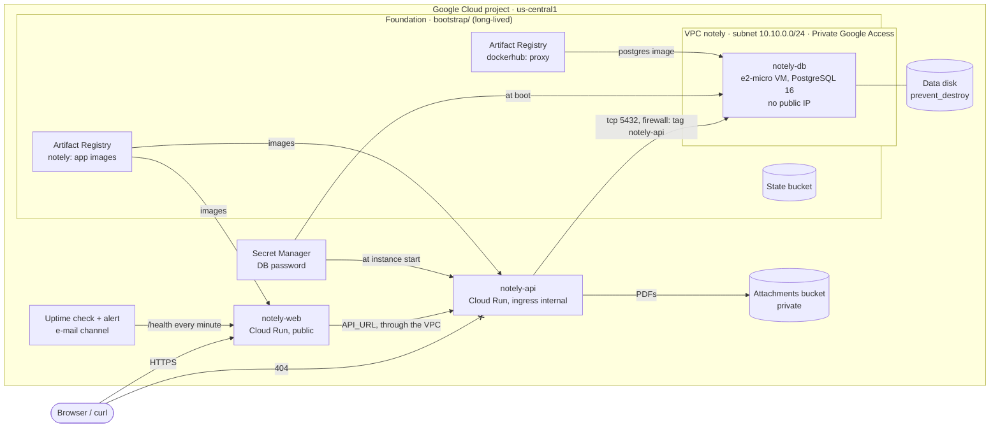
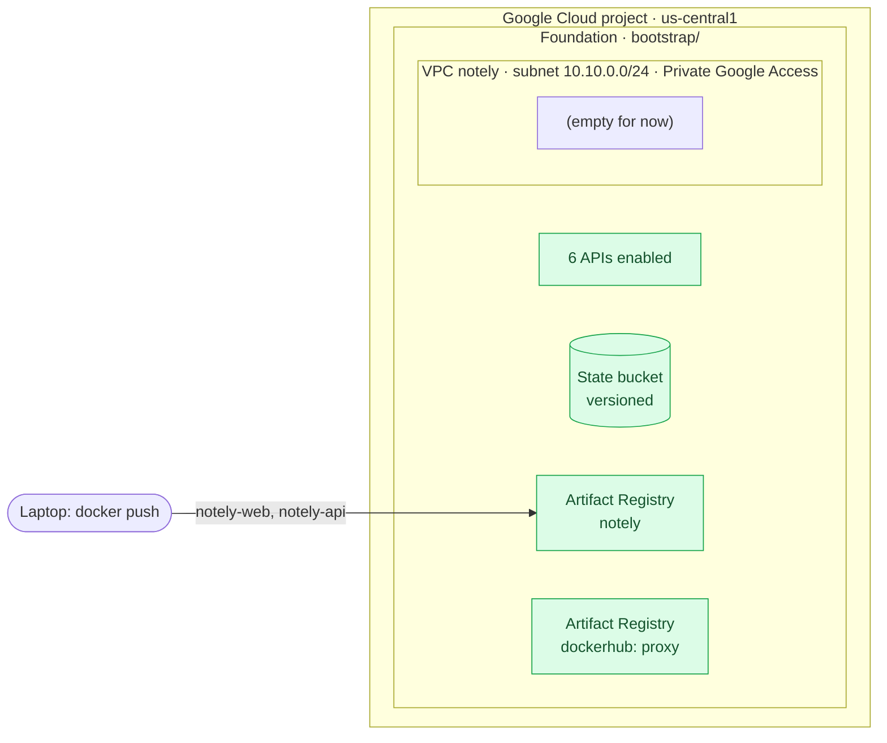
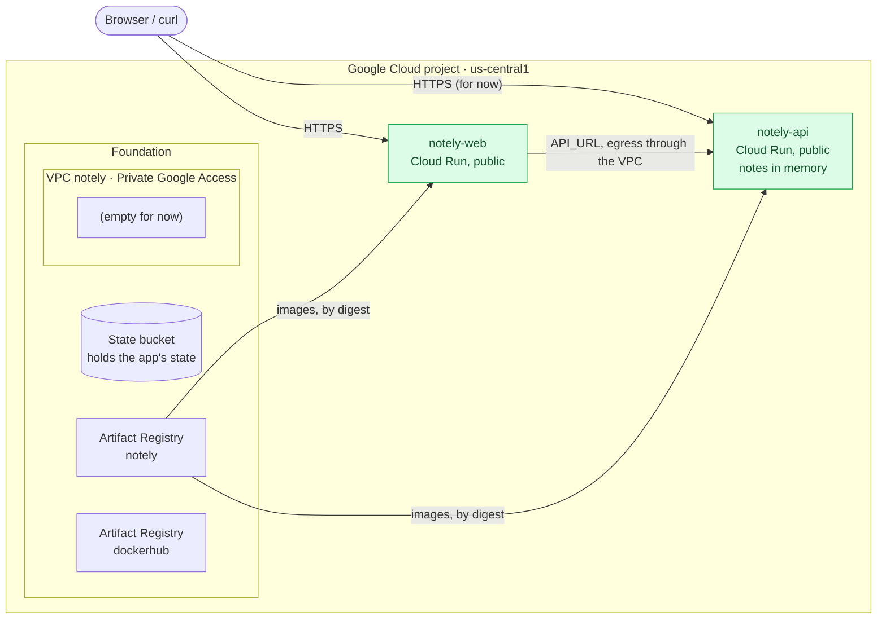
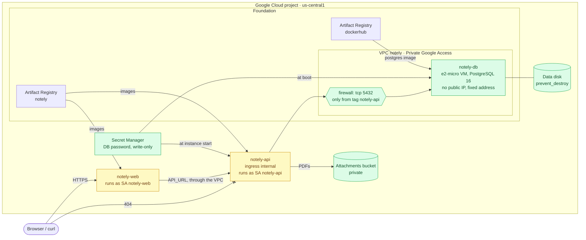
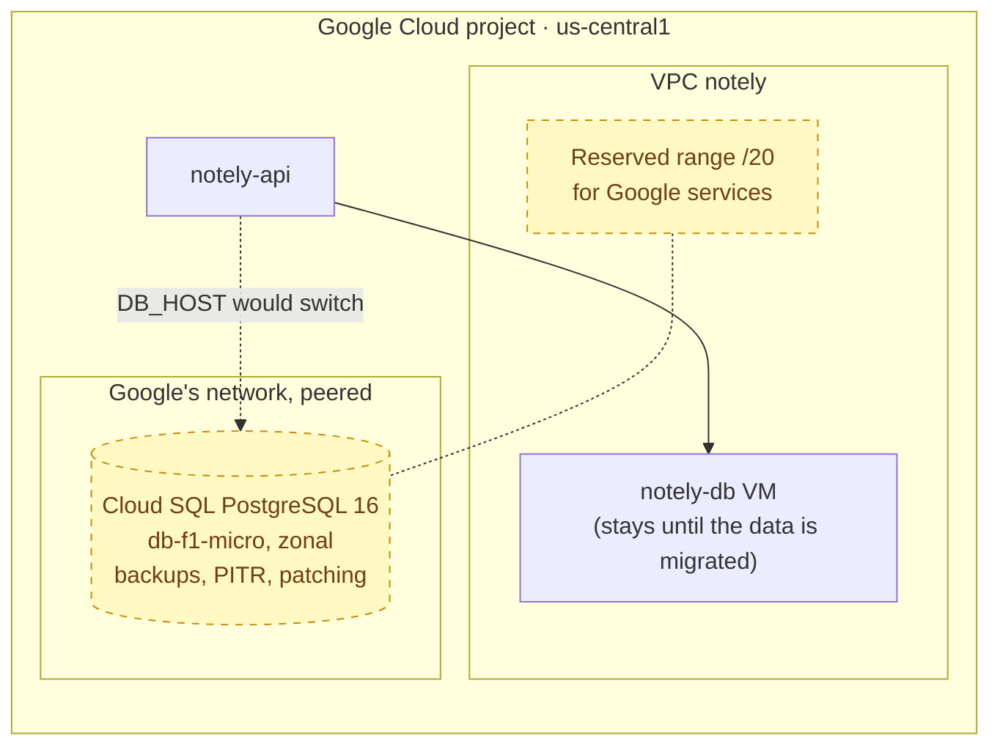
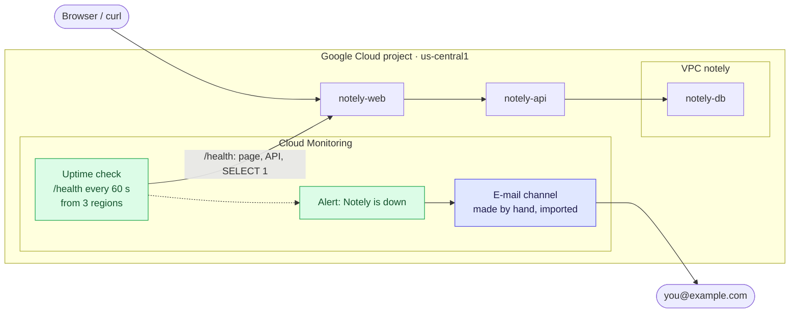
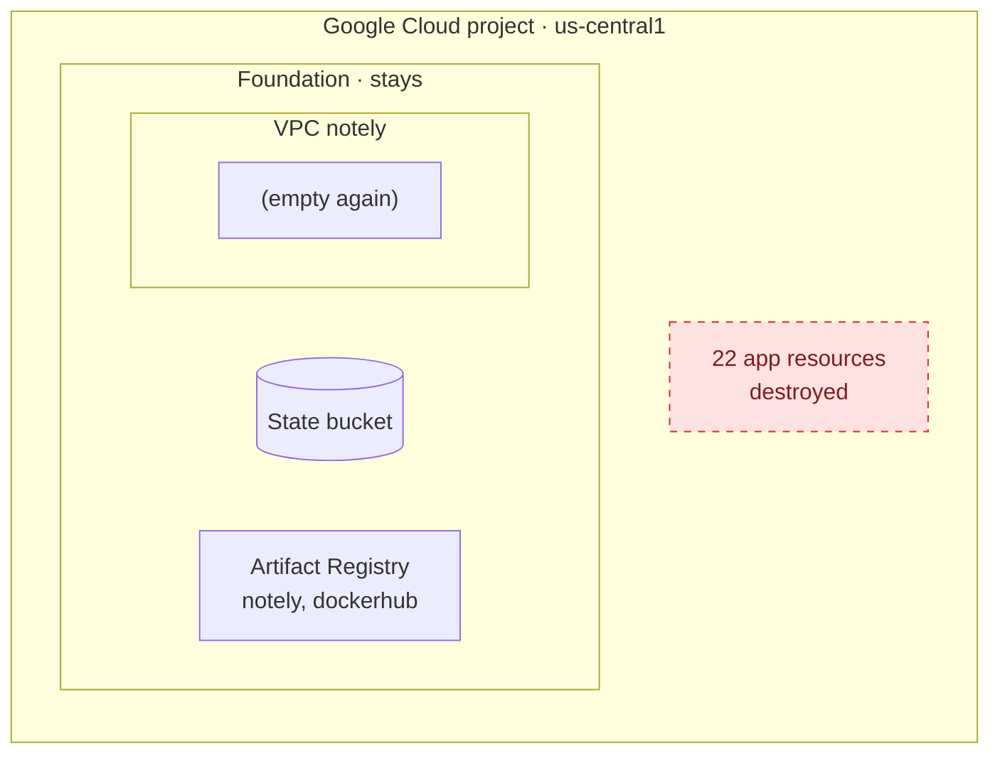

# Terraform live demo — plan

75 min · Master's students, new to Terraform · Terraform 1.16 with the `google` provider pinned ·
region `us-central1` (Iowa), zone `us-central1-a` — the whole stack fits in the Always Free tier.

Outputs below are real, from the last rehearsal, trimmed. Project IDs, URLs and e-mail addresses are
replaced: `<project-id>`, `<project-number>`, `<hash>` (in the `run.app` URLs), `<channel-id>`,
`you@example.com`.

---

## 1. What we deploy

### The app

**Notely**: notes with an optional PDF attached to each one. Two containers:

- **`notely-web`** — the React page, served by a small Node server that is also a reverse proxy:
  it forwards `/api/*` and `/health` to the API (`API_URL`). The browser only ever talks to this one.
- **`notely-api`** — Express API. Notes go to PostgreSQL when `DB_HOST` is set (in memory otherwise);
  PDFs go to a Cloud Storage bucket when `ATTACHMENTS_BUCKET` is set. `/health` runs `SELECT 1`.

### Target architecture

The end state. In section 3 each chunk has its own diagram, with what it adds in green.



### Components and cost

| Component | GCP service | Cost |
|---|---|---|
| Page, API | Cloud Run, scale to zero (`min = 0`, `max = 3`) | free tier |
| Images | Artifact Registry: `notely` (standard) + `dockerhub` (remote repo, Docker Hub proxy) | free < 0.5 GB, cleanup policy keeps the last 2 |
| Database | PostgreSQL 16 container on an `e2-micro` VM (Container-Optimized OS, cloud-init), data on a separate disk; both disks `pd-standard` (10 GB boot + 10 GB data) | free: one `e2-micro` per billing account (counted in hours) + 30 GB of standard disk |
| Attachments | Cloud Storage bucket, private, public access prevention | free < 5 GB (shared with the state bucket) |
| DB password | Secret Manager | free tier |
| Network | VPC + subnet with Private Google Access, firewall rule | free (no Cloud NAT: nothing needs the internet) |
| Identities | one service account per component (`notely-web`, `notely-api`, `notely-db`) | free |
| Monitoring | 1 uptime check + 1 alert policy | ~$0.10/month per alert condition |
| Terraform state | Cloud Storage bucket with versioning | free (same 5 GB) |

Why a VM instead of Cloud SQL: free (Cloud SQL has no free tier), ready in ~1 minute instead of ~12, and
the app code doesn't change. Chunk 3b shows what Cloud SQL would take, as a plan.

---

## 2. How we move during the demo

Two layers, each its own Terraform configuration with its own state:

- **Foundation** ([`infra/bootstrap/`](https://github.com/jorgebg/notely-app/tree/tf/1-foundation/infra/bootstrap)): APIs, the state bucket, the network, the image registries.
  Long-lived: the demo's destroy leaves it.
- **App** ([`infra/`](https://github.com/jorgebg/notely-app/tree/tf/4-operations/infra)): everything else, keeping its state in the foundation's bucket.

The code arrives in four chunks, one branch each, stacked: [`tf/1-foundation`](https://github.com/jorgebg/notely-app/tree/tf/1-foundation), [`tf/2-services`](https://github.com/jorgebg/notely-app/tree/tf/2-services),
[`tf/3-data-security`](https://github.com/jorgebg/notely-app/tree/tf/3-data-security), [`tf/4-operations`](https://github.com/jorgebg/notely-app/tree/tf/4-operations), and [`tf/5-destroy`](https://github.com/jorgebg/notely-app/tree/tf/5-destroy) at the end. One side branch,
[`tf/3b-cloudsql-plan`](https://github.com/jorgebg/notely-app/tree/tf/3b-cloudsql-plan), sits on chunk 3 for a plan-only moment; chunk 4 doesn't build on it.

`git step tf/N-…` puts a chunk's code as uncommitted changes (VS Code marks every new line), you walk
through it, then plan and apply. The talking points and commands also live in each commit message,
which `git step` prints. All commands run in `infra/`.

Once per clone:

```bash
# checkout the chunk, drop leftovers of other chunks under infra/ and .github/ (ignored files such
# as .terraform/, tfplan and demo.env stay), then show its changes as uncommitted
git config alias.step '!f(){ git checkout -q -f --detach "$1" && git clean -fdq -- infra .github && git reset -q HEAD~1 && git log -1 --format=%B "$1"; }; f'
# fixing an early chunk: git rebase -i main from the last branch moves every tf/* branch along
git config rebase.updateRefs true
```

The side branch is not in that line, so after such a rebase move it too:
`git rebase --onto tf/3-data-security <old tf/3-data-security> tf/3b-cloudsql-plan`.

### Before the demo (offstage)

Everything offstage lives in [`infra/offstage/`](https://github.com/jorgebg/notely-app/tree/tf/0-base/infra/offstage):

- `gcloud auth login` and `gcloud auth application-default login` (as yourself).
- `bash infra/offstage/prepare.sh` ([code](https://github.com/jorgebg/notely-app/blob/tf/0-base/infra/offstage/prepare.sh)) — creates the demo project and a guard project on your billing
  account, the `terraform-runner` service account (Owner of the demo project only; Terraform
  impersonates it), every API, the e-mail channel "made by hand" (imported in chunk 4), builds both
  images, and writes `infra/demo.env`. Then `source infra/demo.env` in every terminal (it also sets
  the project for `gcloud`). Run it again after every destroy: it recreates the hand-made channel.
- [`guard/`](https://github.com/jorgebg/notely-app/tree/tf/0-base/infra/offstage/guard) (applied once, as yourself): a EUR 1 budget, and a kill switch that disconnects billing
  from the demo project if the spend passes it. [`check-spend.sh`](https://github.com/jorgebg/notely-app/blob/tf/0-base/infra/offstage/check-spend.sh) reads the latest spend;
  [`check-empty.sh`](https://github.com/jorgebg/notely-app/blob/tf/0-base/infra/offstage/check-empty.sh) lists anything of the app left after a destroy.
- The foundation stays between runs, so you can rehearse back to back. For a session where chunk 1
  should *create* it, destroy it the day before: `terraform -chdir=infra/bootstrap destroy` (the
  subnet can only go 1–2 hours after the last Cloud Run service that used it, see section 4).
- The foundation's state is a local file (`infra/bootstrap/terraform.tfstate`, git-ignored). Present
  from the machine that holds it, or copy it there: without it, chunk 1 would try to create what
  already exists.
- Full rehearsal outputs are kept as a fallback in git-ignored `infra/rehearsal/` (they name the
  real project).

---

## 3. The session

| Min | Part | Budget | Machine time (rehearsal) |
|---|---|---|---|
| 0 | Hook | 3 | — |
| 3 | 1 Foundation | 10 | ~1.5 min + image push ~1 min |
| 13 | 2 Services + the lock | 15 | ~1 min |
| 28 | 3 Data and security | 20 | ~3 min |
| 48 | 3b Cloud SQL, plan only | 3 | ~10 s |
| 51 | 4 Operations + live moments | 15 | ~0.5 min + ~3 min |
| 66 | 5 Destroy | 4 | ~1.5 min |
| 70 | Buffer / questions | 5 | — |

### Hook — 3 min

"You have a deploy script. What happens if you run it twice? And if someone changed a setting in the
console yesterday?" Imperative scripts vs declarative desired state. Idempotence. Show the target
architecture (section 1): by the end of the session it will all be code.

---

### Chunk 1 — Foundation · `tf/1-foundation` · 10 min



Diff on GitHub: [`tf/0-base...tf/1-foundation`](https://github.com/jorgebg/notely-app/compare/tf/0-base...tf/1-foundation)

**The code** — one new file, [`bootstrap/main.tf`](https://github.com/jorgebg/notely-app/blob/tf/1-foundation/infra/bootstrap/main.tf) (a configuration of its own, with a local state):

| Block | What it does | Concept |
|---|---|---|
| `terraform { required_providers }`, `provider "google"` | the plugin that turns HCL into Google API calls, version pinned | providers; `.terraform.lock.hcl` holds the checksums |
| `variable "project_id"`, `variable "region"` | inputs; values from `TF_VAR_*` or a git-ignored `terraform.tfvars` | no project ID in the code |
| `google_project_service.apis` with `for_each` | one resource per API in the set | `for_each`; enabling an enabled API is a no-op |
| `google_storage_bucket.tfstate` | where the app's state will live: versioned, never public | chicken and egg: it can't live in the state it stores |
| `google_compute_network` + `google_compute_subnetwork` | our VPC; Private Google Access lets private machines reach Google APIs | a new VPC denies all incoming traffic |
| `google_artifact_registry_repository.notely` | our images; cleanup policy keeps the newest 2 | stays in the free 0.5 GB |
| `google_artifact_registry_repository.dockerhub` | remote repository: a proxy of Docker Hub | machines without internet can pull public images |
| `depends_on = [google_project_service.apis]` | the bucket needs the Storage API, but no attribute says so | implicit (references) vs explicit dependencies |
| `output "state_bucket"`, `output "registry"` | values to use in the next commands | outputs |

**Run**

```bash
git step tf/1-foundation
terraform -chdir=bootstrap init
terraform -chdir=bootstrap plan -out=tfplan
terraform -chdir=bootstrap apply tfplan
docker push $(terraform -chdir=bootstrap output -raw registry)/notely-web:demo
docker push $(terraform -chdir=bootstrap output -raw registry)/notely-api:demo
```

**Output** (plan from an empty state; read the symbols: `+` create, `~` update in place, `-/+`
replace, `-` destroy)

```text
  # google_artifact_registry_repository.dockerhub will be created
  # google_artifact_registry_repository.notely will be created
  # google_compute_network.notely will be created
  # google_compute_subnetwork.notely will be created
  # google_project_service.apis["artifactregistry.googleapis.com"] will be created
  # google_project_service.apis["compute.googleapis.com"] will be created
  # google_project_service.apis["monitoring.googleapis.com"] will be created
  # google_project_service.apis["run.googleapis.com"] will be created
  # google_project_service.apis["secretmanager.googleapis.com"] will be created
  # google_project_service.apis["storage.googleapis.com"] will be created
  # google_storage_bucket.tfstate will be created

Plan: 11 to add, 0 to change, 0 to destroy.

Changes to Outputs:
  + registry     = (known after apply)
  + state_bucket = "<project-id>-tfstate"
...
Apply complete! Resources: 11 added, 0 changed, 0 destroyed.

Outputs:
registry = "us-central1-docker.pkg.dev/<project-id>/notely"
state_bucket = "<project-id>-tfstate"
```

If the foundation survived the last rehearsal, the plan is shorter or says `No changes`: Terraform
only plans the difference.

**Check**

```bash
gcloud artifacts docker images list $(terraform -chdir=bootstrap output -raw registry) --include-tags
```

```text
IMAGE       TAGS  CREATE_TIME
notely-api  demo  2026-10-30T08:01:31
notely-web  demo  2026-10-30T08:01:22
```

---

### Chunk 2 — Services · `tf/2-services` · 15 min



Diff on GitHub: [`tf/1-foundation...tf/2-services`](https://github.com/jorgebg/notely-app/compare/tf/1-foundation...tf/2-services)

**The code** — the app's configuration, in [`infra/`](https://github.com/jorgebg/notely-app/tree/tf/2-services/infra):

| File | What it does | Concept |
|---|---|---|
| [`versions.tf`](https://github.com/jorgebg/notely-app/blob/tf/2-services/infra/versions.tf) | providers, and `backend "gcs"`: the state goes to the foundation's bucket | remote state; a backend block can't use variables, so the bucket is given at `init` (OpenTofu allows variables there) |
| [`variables.tf`](https://github.com/jorgebg/notely-app/blob/tf/2-services/infra/variables.tf) | `project_id`, `region`; `locals { app = "notely" }` | variables vs locals |
| [`network.tf`](https://github.com/jorgebg/notely-app/blob/tf/2-services/infra/network.tf) | `data "google_compute_network"`, `data "google_compute_subnetwork"` | data sources: read what another layer owns |
| [`images.tf`](https://github.com/jorgebg/notely-app/blob/tf/2-services/infra/images.tf) | `data "google_artifact_registry_docker_image"` for both images | `self_link` pins the image by digest, not by a tag that moves |
| [`modules/cloud_run_service/`](https://github.com/jorgebg/notely-app/tree/tf/2-services/infra/modules/cloud_run_service) | one Cloud Run service + public invoker; inputs `name`, `image`, `env`, `vpc`…; outputs `uri`, `name` | modules; `dynamic "env"` (one block per map entry); `dynamic "vpc_access"` with 0 or 1 element = an optional block |
| [`main.tf`](https://github.com/jorgebg/notely-app/blob/tf/2-services/infra/main.tf) | two module calls; the page gets `API_URL = module.api.uri` and sends all its traffic through our VPC | references create the order (API first); two calls, not `for_each`, because one needs the other's output |
| [`outputs.tf`](https://github.com/jorgebg/notely-app/blob/tf/2-services/infra/outputs.tf) | `url`, `api_url` | values known only after creation |

```hcl
module "web" {
  source   = "./modules/cloud_run_service"
  name     = "${local.app}-web"
  location = var.region
  image    = data.google_artifact_registry_docker_image.web.self_link
  env = {
    API_URL = module.api.uri          # a reference: Terraform creates the API first
  }
  vpc = {                             # nothing visible yet; it matters in chunk 3
    network    = data.google_compute_network.notely.id
    subnetwork = data.google_compute_subnetwork.notely.id
    egress     = "ALL_TRAFFIC"
  }
}
```

**Run**

```bash
git step tf/2-services
terraform init -backend-config="bucket=$(terraform -chdir=bootstrap output -raw state_bucket)"
terraform plan -out=tfplan
terraform apply tfplan
```

**Output**

```text
data.google_compute_network.notely: Read complete after 1s
data.google_artifact_registry_docker_image.api: Read complete after 1s
data.google_compute_subnetwork.notely: Read complete after 1s
data.google_artifact_registry_docker_image.web: Read complete after 1s

  # module.api.google_cloud_run_v2_service.this will be created
  # module.api.google_cloud_run_v2_service_iam_member.invoker will be created
  # module.web.google_cloud_run_v2_service.this will be created
  # module.web.google_cloud_run_v2_service_iam_member.invoker will be created

Plan: 4 to add, 0 to change, 0 to destroy.
...
module.api.google_cloud_run_v2_service.this: Creation complete after 14s
module.api.google_cloud_run_v2_service_iam_member.invoker: Creation complete after 6s
module.web.google_cloud_run_v2_service.this: Creation complete after 12s
module.web.google_cloud_run_v2_service_iam_member.invoker: Creation complete after 6s

Apply complete! Resources: 4 added, 0 changed, 0 destroyed.

Outputs:
api_url = "https://notely-api-<hash>-uc.a.run.app"
url = "https://notely-web-<hash>-uc.a.run.app"
```

The API is created before the page: there is no ordering in the code, the reference did that.

**Check**

```bash
open $(terraform output -raw url)       # the app: create a note; the footer shows who served it
curl -s -X POST -H 'Content-Type: application/json' -d '{"title":"Hello from chunk 2","body":"kept in memory"}' \
  $(terraform output -raw url)/api/notes
curl -s $(terraform output -raw url)/health | jq '{status, storage}'
curl -s -o /dev/null -w '%{http_code}\n' $(terraform output -raw api_url)/health    # the API is public, for now
```

```text
{"id":2,"title":"Hello from chunk 2","body":"kept in memory","createdAt":"…","updatedAt":"…"}
{ "status": "ok", "storage": "memory" }
200
```

**Then the lock** (two terminals, both with `source infra/demo.env`):

```bash
# terminal 1: a plan that changes nothing real, so it stops at the prompt. DON'T answer yet
terraform apply -replace=module.web.google_cloud_run_v2_service_iam_member.invoker
# terminal 2
terraform plan
```

```text
Error: Error acquiring the state lock

Error message: writing "gs://<project-id>-tfstate/notely/default.tflock" failed: googleapi:
Error 412: At least one of the pre-conditions you specified did not hold., conditionNotMet
Lock Info:
  Path:      gs://<project-id>-tfstate/notely/default.tflock
  Operation: OperationTypeApply
  Who:       you@laptop
  Version:   1.16.6
  Created:   2026-10-30 09:19:18 +0000 UTC
```

Answer `no` in terminal 1 (`Apply cancelled.`): nothing changed. Two people can't apply at the same
time and corrupt the state. (A plain `apply` with nothing to do never waits at the prompt, so it
never holds the lock long enough to show this.)

---

### Chunk 3 — Data and security · `tf/3-data-security` · 20 min



Green: new. Yellow: updated in place.

Diff on GitHub: [`tf/2-services...tf/3-data-security`](https://github.com/jorgebg/notely-app/compare/tf/2-services...tf/3-data-security)

**The code**

| File | What it does | Concept |
|---|---|---|
| [`identities.tf`](https://github.com/jorgebg/notely-app/blob/tf/3-data-security/infra/identities.tf) | service accounts `notely-web` (no permissions) and `notely-api` | until now both ran as the project's default account, Editor of everything |
| [`storage.tf`](https://github.com/jorgebg/notely-app/blob/tf/3-data-security/infra/storage.tf) | private attachments bucket; `roles/storage.objectAdmin` for `notely-api` only, on that bucket | `_iam_member` adds one member (what we use); `_iam_binding` owns all members of a role; `_iam_policy` the whole policy. The authoritative ones silently remove grants made by hand |
| [`database.tf`](https://github.com/jorgebg/notely-app/blob/tf/3-data-security/infra/database.tf) | password, VM identity and grants, fixed private address, data disk, the VM, one firewall rule | composing many resources |
| ↳ `ephemeral "random_password"` + `secret_data_wo` | generated during plan/apply, sent to Secret Manager, **never stored in the state** | `sensitive` only hides a value from the screen; write-only never stores it. Bump `secret_data_wo_version` to rotate |
| ↳ `google_compute_instance.db` | Container-Optimized OS, no `access_config` (no public IP), `replace_triggered_by` the secret version | a new password means a new VM, which reads it at boot |
| ↳ `google_compute_disk.db_data` | `prevent_destroy = true` | the VM is cattle, the disk is a pet |
| ↳ `google_compute_firewall.api_to_db` | allow tcp 5432 from tag `notely-api` to tag `notely-db` | everything else is denied by default |
| [`db-cloud-init.yaml`](https://github.com/jorgebg/notely-app/blob/tf/3-data-security/infra/db-cloud-init.yaml) | at every boot: mount (and the first time format) the data disk, read the password from Secret Manager with the VM's identity, start PostgreSQL from the Docker Hub proxy | the password never goes into VM metadata |
| [`main.tf`](https://github.com/jorgebg/notely-app/blob/tf/3-data-security/infra/main.tf) | the API: `ingress = INGRESS_TRAFFIC_INTERNAL_ONLY`, its identity, `DB_HOST`, `DB_PASSWORD` from the secret, a tagged path into the VPC; `depends_on` the secret grant | the page still reaches the API: its traffic leaves through our VPC since chunk 2 |
| [`modules/cloud_run_service/`](https://github.com/jorgebg/notely-app/tree/tf/3-data-security/infra/modules/cloud_run_service) | new inputs `service_account`, `ingress`, `secret_env` | the module grows with the app |
| [`versions.tf`](https://github.com/jorgebg/notely-app/blob/tf/3-data-security/infra/versions.tf) | adds the `random` provider | `terraform init` again |

```hcl
ephemeral "random_password" "db" {
  length  = 32
  special = false
}

resource "google_secret_manager_secret_version" "db_password" {
  secret                 = google_secret_manager_secret.db_password.id
  secret_data_wo         = ephemeral.random_password.db.result   # write-only: never in the state
  secret_data_wo_version = 1                                     # bump to rotate
}
```

**Run**

```bash
git step tf/3-data-security
terraform init -backend-config="bucket=$(terraform -chdir=bootstrap output -raw state_bucket)"
terraform plan -out=tfplan
terraform apply tfplan          # ~3 min: the API waits for the database to boot
```

**Output**

```text
ephemeral.random_password.db: Opening complete after 0s
...
  # google_artifact_registry_repository_iam_member.db_pull will be created
  # google_compute_address.db will be created
  # google_compute_disk.db_data will be created
  # google_compute_firewall.api_to_db will be created
  # google_compute_instance.db will be created
  # google_project_iam_member.db_logs will be created
  # google_secret_manager_secret.db_password will be created
  # google_secret_manager_secret_iam_member.db_password["api"] will be created
  # google_secret_manager_secret_iam_member.db_password["db"] will be created
  # google_secret_manager_secret_version.db_password will be created
  # google_service_account.api will be created
  # google_service_account.db will be created
  # google_service_account.web will be created
  # google_storage_bucket.attachments will be created
  # google_storage_bucket_iam_member.api_attachments will be created
  # module.api.google_cloud_run_v2_service.this will be updated in-place
  ~ resource "google_cloud_run_v2_service" "this" {
      ~ ingress                 = "INGRESS_TRAFFIC_ALL" -> "INGRESS_TRAFFIC_INTERNAL_ONLY"
      ~ template {
          ~ service_account = "<project-number>-compute@developer.gserviceaccount.com" -> "notely-api@<project-id>.iam.gserviceaccount.com"
          ~ containers {
              + env { name = "ATTACHMENTS_BUCKET" ... }
              + env { name = "DB_HOST" ... }
              + env {
                  + name = "DB_PASSWORD"
                  + value_source {
                      + secret_key_ref {
                          + secret  = "notely-db-password"
          + vpc_access {
              + egress = "PRIVATE_RANGES_ONLY"
              + network_interfaces { tags = ["notely-api"] ... }
  # module.web.google_cloud_run_v2_service.this will be updated in-place

Plan: 15 to add, 2 to change, 0 to destroy.
...
google_compute_instance.db: Creation complete after 30s
module.api.google_cloud_run_v2_service.this: Modifications complete after 1m5s
module.web.google_cloud_run_v2_service.this: Modifications complete after 22s

Apply complete! Resources: 15 added, 2 changed, 0 destroyed.
```

**Check**

```bash
curl -s $(terraform output -raw url)/health | jq '{status, storage}'
curl -s -o /dev/null -w '%{http_code}\n' $(terraform output -raw api_url)/health      # from the internet
curl -s $(terraform output -raw url)/api/notes                                         # the chunk 2 note was in memory
curl -s -X POST -H 'Content-Type: application/json' -d '{"title":"Hello from chunk 3","body":"kept in PostgreSQL"}' \
  $(terraform output -raw url)/api/notes
open $(terraform output -raw url)       # attach a PDF to the note, download it
PW=$(gcloud secrets versions access latest --secret=notely-db-password)
[ -n "$PW" ] && terraform state pull | grep -c -- "$PW"                               # the real password in the state?
```

```text
{ "status": "ok", "storage": "postgres" }
404
[]
{"id":1,"title":"Hello from chunk 3", ...}
0
```

`[]`: the note from chunk 2 is gone, it lived in memory. `0`: the 32-character password appears
nowhere in the state.

---

### Chunk 3b — Cloud SQL, plan only · `tf/3b-cloudsql-plan` · 3 min

"Why a VM and not Cloud SQL?"



Dashed: planned, never applied.

Diff on GitHub: [`tf/3-data-security...tf/3b-cloudsql-plan`](https://github.com/jorgebg/notely-app/compare/tf/3-data-security...tf/3b-cloudsql-plan)

**The code**

| File | What it does |
|---|---|
| [`cloudsql.tf`](https://github.com/jorgebg/notely-app/blob/tf/3b-cloudsql-plan/infra/cloudsql.tf) (new) | the two APIs (`sqladmin`, `servicenetworking`); **private services access**: a reserved range of our addresses and a peering with Google's network; the instance (`POSTGRES_16`, `db-f1-micro`, `ZONAL`, no public IP, daily backups, point-in-time recovery, a maintenance window, `deletion_protection`); a database and a write-only user |
| [`main.tf`](https://github.com/jorgebg/notely-app/blob/tf/3b-cloudsql-plan/infra/main.tf) | one line: the API's `DB_HOST` points at `google_sql_database_instance.notely.private_ip_address` instead of the VM |

**Run**

```bash
git step tf/3b-cloudsql-plan
terraform plan           # PLAN ONLY. Don't apply
```

**Output**

```text
  # google_compute_global_address.cloudsql will be created
  # google_project_service.cloudsql["servicenetworking.googleapis.com"] will be created
  # google_project_service.cloudsql["sqladmin.googleapis.com"] will be created
  # google_service_networking_connection.cloudsql will be created
  # google_sql_database.notely will be created
  # google_sql_database_instance.notely will be created
  # google_sql_user.notely will be created
  # module.api.google_cloud_run_v2_service.this will be updated in-place
              - env {
                  - name  = "DB_HOST" -> null
                  - value = "10.10.0.5" -> null
                }
              + env {
                  + name  = "DB_HOST"
                  + value = (known after apply)
                }

Plan: 7 to add, 1 to change, 0 to destroy.
```

**Check:** nothing: it isn't applied. The price of what the plan shows: no free tier (~10 USD/month,
~20 with a standby), ~12 minutes to create, and the peering is slow to delete. The VM: free, ready in
a minute, and backups, high availability and patching are now our job.

---

### Chunk 4 — Operations · `tf/4-operations` · 7 min, then the live moments



Green: new. Blue: existed before (clicked in the console), now managed by Terraform.

Diff on GitHub: [`tf/3-data-security...tf/4-operations`](https://github.com/jorgebg/notely-app/compare/tf/3-data-security...tf/4-operations)

**The code** ([`monitoring.tf`](https://github.com/jorgebg/notely-app/blob/tf/4-operations/infra/monitoring.tf), plus two variables)

| Block | What it does | Concept |
|---|---|---|
| `google_monitoring_uptime_check_config.page` | GET `/health` on the page every minute from 3 regions; the host comes from `module.web.uri` | one probe covers page, proxy, API and database |
| `import { to = …email, id = var.notification_channel }` + its resource | adopts the channel someone created in the console | import blocks: reviewed like code, run by whoever applies next; `terraform plan -generate-config-out=x.tf` can draft the resource |
| `google_monitoring_alert_policy.app_down` | fires when the check fails from more than one region for 5 minutes, notifies the channel | the imported resource is an ordinary part of the graph |
| [`variables.tf`](https://github.com/jorgebg/notely-app/blob/tf/4-operations/infra/variables.tf) | `alert_email`, `notification_channel` | from `demo.env` |

**Run**

```bash
git step tf/4-operations
terraform plan -out=tfplan
terraform apply tfplan
```

**Output**

```text
  # google_monitoring_alert_policy.app_down will be created
  # google_monitoring_notification_channel.email will be imported
    resource "google_monitoring_notification_channel" "email" {
        display_name        = "Notely alerts"
        id                  = "projects/<project-id>/notificationChannels/<channel-id>"
        labels              = {
            "email_address" = "you@example.com"
        }
        type                = "email"
    }
  # google_monitoring_uptime_check_config.page will be created

Plan: 1 to import, 2 to add, 0 to change, 0 to destroy.
...
Apply complete! Resources: 1 imported, 2 added, 0 changed, 0 destroyed.
```

**Check**

```bash
gcloud monitoring uptime list-configs --format="table(displayName,period,httpCheck.path)"
```

```text
DISPLAY_NAME         PERIOD  PATH
Notely page /health  60s     /health
```

Console: Monitoring > Uptime checks (green after a minute or two) and Alerting (the policy, with the
imported channel).

#### Live moments — still on chunk 4's code, nothing to check out

**Drift.** Console: Cloud Run > notely-api > Networking > Ingress: **All**, save.

```bash
curl -s -o /dev/null -w '%{http_code}\n' $(terraform output -raw api_url)/health   # open to the internet
terraform plan -out=tfplan
terraform apply tfplan
curl -s -o /dev/null -w '%{http_code}\n' $(terraform output -raw api_url)/health   # closed again
```

```text
200
      ~ ingress                 = "INGRESS_TRAFFIC_ALL" -> "INGRESS_TRAFFIC_INTERNAL_ONLY"
Plan: 0 to add, 1 to change, 0 to destroy.
Apply complete! Resources: 0 added, 1 changed, 0 destroyed.
404
```

Terraform reads the real world on every plan. The code is the source of truth.

**Pets and cattle.**

```bash
terraform apply -replace=google_compute_instance.db        # ~2 min: "-/+", destroy then create
curl -s $(terraform output -raw url)/health | jq .status    # repeat until "ok" (the VM boots, ~1 min)
curl -s $(terraform output -raw url)/api/notes | jq '[.[] | .title]'
terraform plan -replace=google_compute_disk.db_data
```

```text
  # google_compute_instance.db will be replaced, as requested
Plan: 1 to add, 0 to change, 1 to destroy.
Apply complete! Resources: 1 added, 0 changed, 1 destroyed.
"ok"
["Hello from chunk 3"]

Error: Instance cannot be destroyed

  on database.tf line 75:
  75: resource "google_compute_disk" "db_data" {

Resource google_compute_disk.db_data has lifecycle.prevent_destroy set, but
the plan calls for this resource to be destroyed.
```

The VM is rebuilt from code and the notes survive on the disk; destroying the disk is an error, not a
prompt.

**OpenTofu, an honest difference.** 2023: HashiCorp moved Terraform to the BSL licence; the community
forked the last open version as OpenTofu (Linux Foundation, MPL). Same language, same providers. A
drop-in? Same code, same state, on a copy of the folder:

```bash
rm -rf /tmp/tofu-demo && cp -r . /tmp/tofu-demo && cd /tmp/tofu-demo && rm -rf .terraform tfplan
tofu init -backend-config="bucket=$(terraform -chdir=bootstrap output -raw state_bucket)"
tofu plan
cd - && terraform plan
```

```text
  # google_compute_instance.db will be replaced due to changes in replace_triggered_by
  # google_secret_manager_secret_version.db_password will be updated in-place
Plan: 1 to add, 1 to change, 1 to destroy.

No changes. Your infrastructure matches the configuration.
```

OpenTofu plans an update of the write-only password version and, through `replace_triggered_by`, a
new database VM; Terraform plans nothing. On newer features the tools diverge: read the plan, whatever
the tool. (Not applied.)

**CI (slide).** In a team nobody applies from a laptop: a pipeline posts `terraform plan` on every
pull request, a colleague reviews code and plan, merging applies it. Keyless, with Workload Identity
Federation. When the app has its own deploy pipeline, `ignore_changes` on the image keeps Terraform
from rolling it back.

---

### Chunk 5 — Destroy · `tf/5-destroy` · 4 min



Diff on GitHub: [`tf/4-operations...tf/5-destroy`](https://github.com/jorgebg/notely-app/compare/tf/4-operations...tf/5-destroy)

**The code** — [`database.tf`](https://github.com/jorgebg/notely-app/blob/tf/5-destroy/infra/database.tf): `prevent_destroy` removed. To destroy a protected resource you change
the code first: a decision someone reviews, not a click.

**Run**

```bash
git step tf/5-destroy
terraform apply -auto-approve         # removes the guard; changes nothing in the cloud
terraform destroy
```

**Output**

```text
  # google_compute_instance.db will be destroyed
  ...
  # module.web.google_cloud_run_v2_service.this will be destroyed
  # module.web.google_cloud_run_v2_service_iam_member.invoker will be destroyed

Plan: 0 to add, 0 to change, 22 to destroy.
...
Destroy complete! Resources: 22 destroyed.
```

**Check**

```bash
bash offstage/check-empty.sh
```

```text
Resources left in <project-id>:
(nothing)
```

Only the app's resources were in the plan. The foundation stays: it costs nothing, and a subnet can't
even be deleted for 1–2 hours after the last Cloud Run service that used it. Everything is in Git:
`terraform apply` would rebuild the app in minutes.

---

## 4. What the rehearsals showed

- **Cloud Run deploys vary a lot.** Most updates took 10–75 s; some took 2–6 minutes, all of it in
  Google's "Container image import" (the container itself was healthy in 3 s). Talk over the wait;
  if it drags, show the recorded output.
- **A new path through the VPC can take minutes to count as "internal".** In the first rehearsal the
  API answered the page with 404 for ~6 minutes after the network and the page's egress were created
  together. That is why the network is in the foundation and the page's egress in chunk 2: by
  chunk 3 the path is ready, and closing the API takes effect at once.
- **OpenTofu is not a drop-in on write-only attributes.** OpenTofu 1.13 plans an in-place update of
  the write-only secret version on every run, and through `replace_triggered_by` that would replace
  the database VM. Terraform plans "No changes".
- **A subnet outlives its Cloud Run services by 1–2 hours** (Google documents it): deleting it fails
  with "already being used by ... serverless-ipv4-..." until then. One more reason the network lives in
  the foundation.
- **`gcloud` needs its own project setting.** It ignores `GOOGLE_CLOUD_PROJECT`; `demo.env` sets
  `CLOUDSDK_CORE_PROJECT`. Without it, the password check printed the number of lines of the state
  (an empty pattern matches every line); the check now refuses an empty password.
- **Live moments run on chunk 4's code.** `git step tf/5-destroy` removes `prevent_destroy`, so the
  disk check must come before it.
